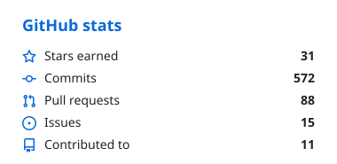
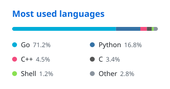

# Egor Merkushev

Go developer · Saint Petersburg

I build backend services, command-line tools and small native apps that do one
thing well. I like getting close to the hardware: reading Mac sensors over SMC,
automating home routers.

## 🚀 Featured projects

**[Pulse](https://github.com/emgeorrk/pulse)**   
Native macOS menu bar system monitor: CPU, memory, network, temperatures, fans and power.
The popular GNOME extension Vitals, rebuilt for the Mac. 
`brew install emgeorrk/tap/pulse`

**[wrtgram](https://github.com/emgeorrk/wrtgram)**  
Telegram bot for OpenWrt routers. Status, connected devices, VPN failover, encrypted
backups and security alerts in a single static Go binary.

**[market-comparison](https://github.com/emgeorrk/market-comparison)** · [live demo](https://emgeorrk.github.io/market-comparison/) 
Interactive D3 dashboard that compares housing markets, stock indices, currencies and gold
since 2000. The data refreshes monthly through GitHub Actions.

## 🛠 Tech stack

## 📊 GitHub stats

  <picture>
    <source media="(prefers-color-scheme: dark)" srcset="assets/stats-dark.svg">
    
  </picture>
  <picture>
    <source media="(prefers-color-scheme: dark)" srcset="assets/langs-dark.svg">
    
  </picture>

<picture>
  <source media="(prefers-color-scheme: dark)" srcset="https://streak-stats.demolab.com?user=emgeorrk&hide_border=true&theme=github-dark-blue">
  
</picture>
